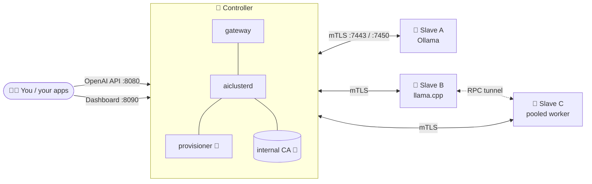

<div align="center">

```
   ____  __    ____     ___    ____
  / __ \/ /   / __ \   /   |  /  _/
 / / / / /   / / / /  / /| |  / /
/ /_/ / /___/ /_/ /  / ___ |_/ /
\____/_____/_____/  /_/  |_/___/

  🪩  your dusty old PCs, now a groovy little AI cluster  🪩
```

[](https://github.com/Njordics/OldAI/actions/workflows/update-bundle.yml)


**Burn two ISOs. Boot your old boxes. Get one OpenAI-compatible endpoint.**
<br/>No YAML sermons, no SSH-ing into ten machines, no tears.

</div>

---

## 🕺 What is this?

OldAI turns a pile of forgotten desktops (the HP in the closet, the ex-gaming tower, that ProDesk you swore you'd sell) into a **self-assembling local AI cluster**.

- 🧠 **One Controller** runs the brains: dashboard, OpenAI-style gateway, model catalog, internal CA.
- 🦾 **Many Slaves** do the heavy lifting: Ollama and llama.cpp, running whatever the Controller tells them.
- 🔍 Slaves **find the Controller on their own**, get adopted, and from then on talk only over **mTLS**.
- 🧩 Models too big for one box get **pooled** across several nodes over llama.cpp's RPC.
- 🎮 **NVIDIA cards just work:** the Controller picks the right driver from Ubuntu's archive and the Slave installs it through the Controller, no internet needed.
- 🔄 **One-button updates** roll the whole cluster forward, Controller first, then each Slave in turn, with automatic rollback.

All of it runs on your LAN. Slaves never touch the internet. Your prompts never leave the building. 🏠

## 🎛️ How it grooves



1. 💿 **Install.** Boot the Controller ISO on one machine and the Slave ISO on the rest. Both installs are unattended.
2. 📡 **Discover.** Slaves shout into the LAN (mDNS + beacon), and the Controller hears them.
3. 🤝 **Adopt.** Click adopt, or let auto-adopt do it. The node gets a CA-signed certificate.
4. 🏝️ **Isolate.** Adopted Slaves move onto the Controller's own subnet (`10.10.10.0/24` by default). The Controller is their DHCP, DNS and only friend.
5. 🚀 **Serve.** Pick a model in the dashboard. The provisioner works out where it fits, the Slaves pull it through the Controller, and you chat.

## ⚡ Quick start

> ⚠️ **The installers wipe every internal disk without asking.** That's the point of an unattended image. Don't leave the stick in a machine you love.

**1. Build the ISOs** (Linux, or WSL with Ubuntu 24.04 on Windows):

```bash
make isos
```

You get `out/aicluster-controller-<version>.iso` and `out/aicluster-slave-<version>.iso`. Flash them to USB sticks with anything that writes ISOs.

**2. Boot the Controller.** When it's done, its console shows the dashboard URL, the OpenAI API URL and a **login code** (`XXXX-XXXX`).

**3. Boot the Slaves.** They appear in the dashboard by themselves. 🪄

**4. Talk to it:**

```bash
curl http://<controller>:8080/v1/chat/completions \
  -H "Authorization: Bearer $AICLUSTER_KEY" \
  -H "Content-Type: application/json" \
  -d '{"model":"qwen2.5:1.5b","messages":[{"role":"user","content":"drop a funky beat"}]}'
```

Any OpenAI SDK works too: just point `base_url` at the Controller.

## 🧰 The toolbox

| Thing | What it does |
|---|---|
| 🖥️ **Dashboard** `:8090` | Nodes, models, keys, settings, updates. Sign in with the console's login code. |
| 🔌 **Gateway** `:8080` | `/v1/chat/completions`, `/v1/completions`, `/v1/embeddings` |
| ⌨️ **`aicluster` CLI** | `nodes ls`, `adopt`, `release`, `keys create`, `settings` … |
| 📚 **Catalog** | Llama, Qwen 2.5 (+ Coder), Mistral, Gemma 2, Phi 3.5, DeepSeek-R1, LLaVA, embeddings. See [`catalog/`](catalog/). |
| 📈 **Metrics** `:9464` | Prometheus, with `/sd/nodes` service discovery |

## 🔄 Updates, but make it smooth

Settings → **Check now** → *"Update available"* → **Update Controller and Slaves now** 🎉

- On every push to `main`, CI builds an update bundle and publishes it on the `update-main` release.
- The Controller downloads it, checks the sha256 and installs it on itself.
- Then it updates each Slave in turn, waiting until each one is confirmed healthy.
- If a build doesn't stay up, that machine **rolls back by itself** and the rollout stops. 🛟

> 🔐 Whoever can push to the repo and branch you update from can ship code to your cluster. Point Settings → Updates at a repo you control.

## 🏗️ Hacking on it

```bash
make vet test     # 🧪 unit + integration tests (a whole fake cluster in-process)
make build        # 🔨 linux/amd64 binaries in bin/
make update-bundle
```

```
controller/   🧠 aiclusterd, gateway, dashboard, CLI, provisioner client
slave-agent/  🦾 aicluster-agent: runtimes, netcfg, self-update
common/       🧬 protocol, PKI, discovery, pairing, selfupdate
iso/          💿 autoinstall ISO builder + on-disk payload
catalog/      📚 model definitions
test/         🧪 integration harness and fakes
docs/         📖 the deep lore
```

## 📖 Deep lore

| Doc | For when you want to know… |
|---|---|
| [architecture.md](docs/architecture.md) | how all the pieces fit |
| [protocol.md](docs/protocol.md) | every byte between Controller and Slave |
| [iso.md](docs/iso.md) | building, installing, disk wipe, the Slave network, updating |
| [ports.md](docs/ports.md) | what listens where, and who's allowed in |
| [dashboard-trust.md](docs/dashboard-trust.md) | trusting the dashboard's certificate |

## 🚧 Not yet

- 🎮 NVIDIA drivers install themselves through the Controller, but haven't met a real card yet. AMD and Intel GPUs still run on the CPU.
- 🧪 Tested on QEMU/KVM VMs and a real HP ProDesk. Your weird 2011 tower? Let us know how it goes.

<div align="center">

---

**Made with 🪩, ☕ and a stubborn refusal to throw away working hardware.**

</div>
