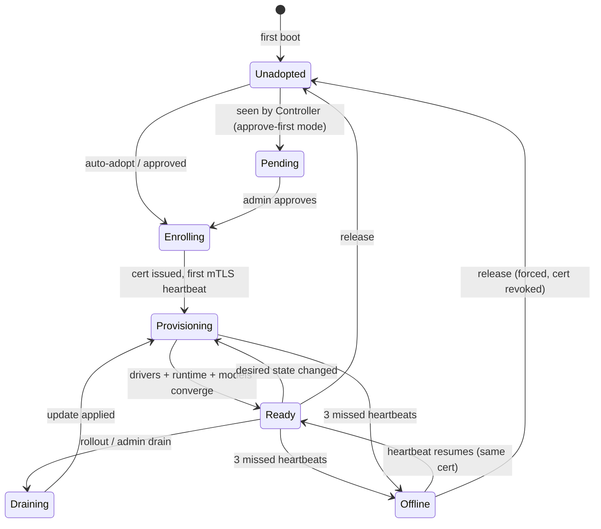
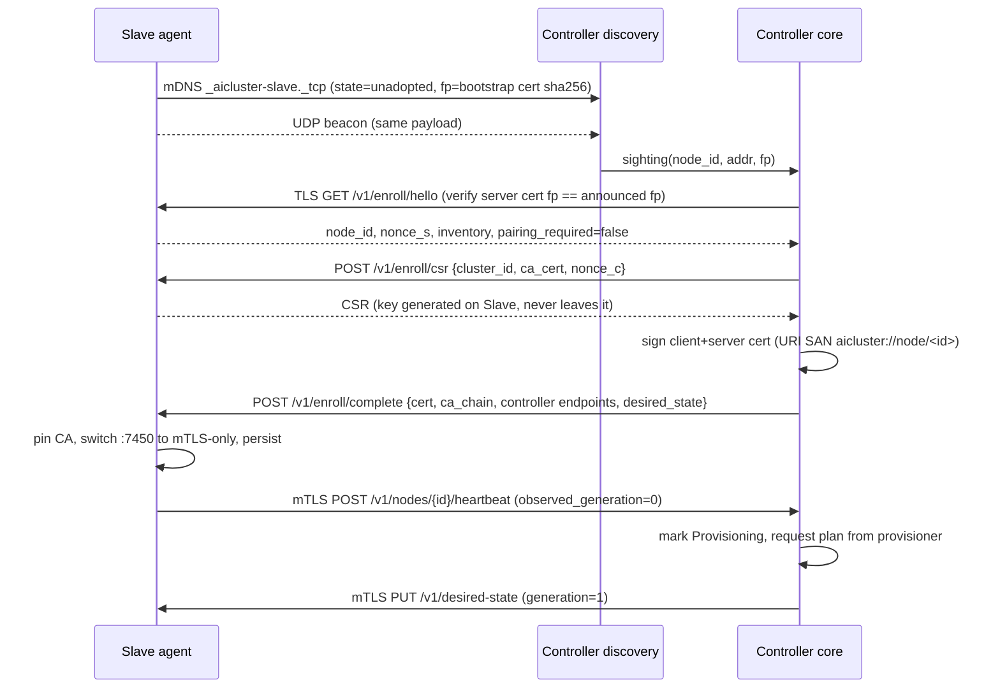

# AI Cluster — Architecture

Status: **draft for review** (build step 1)
Protocol details live in [protocol.md](protocol.md); ports in [ports.md](ports.md).

## 1. Decisions

| Topic | Decision |
|---|---|
| Base OS | Ubuntu Server 24.04 LTS, headless, autoinstall (cloud-init) ISO + raw USB image |
| Languages | **Go** for everything on the hot path and on Slaves (agent, discovery, CA, gateway, CLI, dashboard). **Python** for the provisioning engine (catalog, upstream refresh, fit calculation, placement policies). |
| Slave egress | **None.** Slaves reach only the Controller. Apt packages, GPU drivers, runtimes, agent updates and model blobs are all served/proxied by the Controller. |
| Trust | Controller runs an internal CA. Slave identity = CA-signed client cert. All post-adoption traffic is mTLS both ways. |
| State | Controller: SQLite (WAL) owned by the Go core; Postgres optional via the same repository interface. Slave: small JSON state files in `/var/lib/aicluster`. |
| Control model | **Declarative.** The Controller pushes a versioned *desired state* to each Slave; the agent reconciles and reports *observed state* in heartbeats. Re-sending is always safe, which gives idempotency across reboots/reinstalls. |
| Test harness | Proxmox: 1 Controller VM + 3 Slave VMs on an isolated bridge, booted from the real ISOs. CPU-only, tiny models. |

## 2. Component diagram

```mermaid
flowchart LR
  subgraph Clients
    APP[Apps / SDKs<br/>OpenAI-compatible]
    ADM[Admin<br/>CLI / browser]
  end

  subgraph CTRL[Controller OS]
    direction TB
    GW[gateway<br/>:8080 OpenAI API]
    MGMT[mgmt API + dashboard<br/>:8090]
    CORE[aiclusterd core<br/>registry · adoption · scheduler<br/>rollout · health]
    DISC[discovery<br/>mDNS + beacon listener]
    CA[internal CA]
    PROV[provisioner (Python)<br/>catalog · fit · placement]
    NODEAPI[node API :7443 mTLS<br/>heartbeat · cert renew<br/>model blobs · apt · repo]
    CACHE[(model cache<br/>/var/lib/aicluster/models)]
    APT[(apt cache +<br/>aicluster repo)]
    DB[(SQLite)]
    CORE --- DB
    CORE --- CA
    CORE <-->|unix socket| PROV
    DISC --> CORE
    GW --> CORE
    MGMT --> CORE
    NODEAPI --- CACHE
    NODEAPI --- APT
    NODEAPI --> CORE
  end

  subgraph SLAVE[Slave OS  ×N]
    direction TB
    AG[aicluster-agent<br/>:7450 TLS → mTLS]
    HW[hw inventory]
    DRV[driver installer]
    RT[runtime<br/>Ollama / llama.cpp / vLLM / whisper<br/>bound to 127.0.0.1]
    SHIM[registry shim<br/>127.0.0.1:7452]
    AG --- HW
    AG --- DRV
    AG -->|reverse proxy| RT
    RT -->|ollama pull| SHIM
  end

  INTERNET((Internet<br/>Ollama library · Hugging Face<br/>Ubuntu / NVIDIA / ROCm repos))

  APP -->|API key| GW
  ADM --> MGMT
  GW -->|mTLS /v1/infer/*| AG
  CORE -->|mTLS desired state, ops| AG
  AG -->|mTLS heartbeat| NODEAPI
  SHIM -->|mTLS blobs| NODEAPI
  AG -.->|mDNS / UDP beacon| DISC
  CACHE -. fetch once .-> INTERNET
  APT -. proxy .-> INTERNET
```

## 3. Controller services

All Go services ship as one binary `aiclusterd` with subcommands, run as separate systemd units so each one can restart without taking the others down.

| Unit | Role |
|---|---|
| `aiclusterd-core` | Node registry, adoption state machine, CA, desired-state generator, health monitor, rollout engine, job tracking. Sole writer of SQLite. Exposes an internal gRPC-free JSON API on `/run/aicluster/core.sock`. |
| `aiclusterd-discovery` | Browses `_aicluster-slave._tcp`, listens on UDP beacon port, feeds sightings to core. Also announces `_aicluster-ctrl._tcp` so Slaves can re-find the Controller after a DHCP address change. |
| `aiclusterd-nodeapi` | mTLS endpoint for Slaves (`:7443`): heartbeats, cert renewal, model blob server, apt proxy, aicluster package repo. |
| `aiclusterd-gateway` | OpenAI-compatible API (`:8080`), API-key auth, routing, queueing, failover. Reads a routing table snapshot from core (pushed on change, plus 1 s poll fallback). |
| `aiclusterd-web` | Management REST API + embedded dashboard (`:8090`). The CLI `aicluster` talks to this API (or to the unix socket when run locally as root). |
| `aicluster-provisioner` (Python) | Catalog loading/validation, upstream refresh (Ollama library, Hugging Face), fit calculation, placement policy. Stateless with respect to the cluster: core sends it node inventories + current assignments, it returns a plan. Owns only its catalog cache under `/var/lib/aicluster/catalog-cache`. Unix socket `/run/aicluster/provisioner.sock`. |
| `apt-cacher-ng` | Upstream apt proxy, bound to 127.0.0.1, exposed to Slaves only through nodeapi's mTLS `/apt/` path. |

### Go ↔ Python boundary

Core calls the provisioner over HTTP/JSON on the unix socket:

- `POST /plan` — input: nodes (inventory + health), catalog version, policy, current assignments; output: target assignments per node with chosen runtime + quantisation, and a human-readable reason per decision.
- `GET /catalog` / `POST /catalog/refresh` — catalog read and scheduled refresh.
- `POST /fit` — single "does model M fit node N" query (used by dashboard "assign" button).

The provisioner never talks to Slaves and never writes the cluster DB. If it is down, the cluster keeps serving; only re-planning pauses.

## 4. Slave services

| Unit | Role |
|---|---|
| `aicluster-agent` | Single Go binary. Announces, serves enrollment, then mTLS command API. Reconciles desired state (drivers → runtime → models). Sends heartbeats. Reverse-proxies inference to the runtime. Exposes metrics. |
| `aicluster-registry-shim` | Part of the agent binary (goroutine, not a unit). Loopback-only OCI-registry façade so `ollama pull 127.0.0.1:7452/library/…` fetches blobs from the Controller over mTLS. Like registry.ollama.ai it answers blob requests with a 307 to a direct-download URL on the other loopback name (`localhost` ↔ `127.0.0.1`, listening on `[::1]` too), because Ollama only accepts a redirect to a different host. |
| runtime units | `aicluster-runtime-ollama`, `-llamacpp@<model>`, `-vllm@<model>`, `-whisper`. Installed and enabled by the agent; always bound to `127.0.0.1`. |

The Slave has **no SSH by default**. The console shows a status screen (node ID, IP, state, pairing code if required) and a single local escape hatch: `aicluster-agent factory-reset` from the physical console.

## 5. Lifecycle



`Pending`, `Offline` and `Draining` are Controller-side states; the Slave only knows `unadopted`, `enrolling`, `adopted`.

## 6. Key flows

### 6.1 Adoption (auto mode)



### 6.2 Provisioning (reconcile loop on the Slave)

1. **Drivers** — from inventory: NVIDIA → `nvidia-driver-<branch>-server` + CUDA runtime libs; AMD → ROCm; Intel → `intel-opencl-icd`/oneAPI level-zero; none → CPU. Packages come through the Controller apt proxy. If a driver install needs a reboot, the agent reports `reboot_required` and reboots only when the desired state has `allow_reboot: true` (the Controller sets this for nodes not currently serving).
2. **Runtime** — install/upgrade the requested runtime packages from the Controller's aicluster repo (Ollama and llama.cpp binaries are repackaged as `.deb` on the Controller side; vLLM ships as a pinned wheelhouse).
3. **Models** — for each assigned model: fetch via shim (Ollama) or nodeapi `/blobs/` (GGUF/HF), verify sha256, load/warm, report progress per layer. Unassigned models are unloaded, and deleted after `gc_grace` (default 24 h) so a flapping plan does not cause re-downloads.
4. Report `observed_generation` = desired generation once all steps succeed.

### 6.3 Inference request

```mermaid
sequenceDiagram
  participant A as Client
  participant G as Gateway
  participant S1 as Slave 1
  participant S2 as Slave 2
  A->>G: POST /v1/chat/completions (model=qwen2.5:7b, Bearer key)
  G->>G: auth, resolve alias → candidates [S1,S2] (healthy, model loaded)
  G->>G: pick least in-flight/slots; if all full → per-model queue (bounded, timeout)
  G->>S1: mTLS POST /v1/infer/ollama/v1/chat/completions
  S1--xG: connection error (before first byte)
  G->>S2: retry on next candidate
  S2-->>G: SSE stream
  G-->>A: SSE stream (pass-through, no retry once bytes sent)
```

### 6.4 Node failure and return

- Heartbeat every **5 s**. Missing for **15 s** → `Offline`: gateway drops it from routing immediately, queued requests go to other candidates.
- If an `Offline` node held the *only* copy of a model and the policy is `spread`, core re-plans after `offline_replan_after` (default 5 min) to place that model elsewhere.
- When the node returns with its still-valid cert, it simply resumes heartbeats → `Provisioning` → `Ready`. No re-adoption needed.
- If the node was **reinstalled** (new keys, new node_id), the Controller matches its **hardware fingerprint** (DMI product UUID + sorted physical MACs). Auto mode: re-adopt and restore its previous name and assignments. Approve-first mode: shown as "returning node" in the pending list.

### 6.5 Rolling updates

The dashboard's Update button (protocol §13):
1. **Controller first.** It downloads the CI-built bundle for the branch's newest commit and checks GitHub's SHA-256. A root-owned updater installs the bundle and restarts the Controller, rolling back if it doesn't stay up.
2. **Then the Slaves, one at a time.** The restarted Controller puts the update in one node's desired state. That agent fetches the bundle from the Controller, checks it, and has the same updater install it.
3. **Pacing.** The next node starts only after the current one heartbeats on the new commit, and the first failure stops the rollout.

Not done yet:
- draining a node's models before its agent restarts;
- runtime and OS package updates.

## 7. Model provisioning engine (Python)

- **Catalog** = YAML files in `/catalog` (shipped in the Controller package, overridable in `/etc/aicluster/catalog.d/`). One entry per model family with variants per size and quantisation. See schema in protocol.md §7.
- **Refresh job** (default daily, systemd timer): for Ollama entries, resolve manifest digests from the Ollama registry; for HF entries, resolve the latest commit of a pinned repo/revision policy. A changed digest makes a new *catalog version*; core rolls it out like any other desired-state change.
- **Fit**: `need = weights + kv_cache(ctx_default, layers, kv_heads, head_dim, kv_dtype) + runtime_overhead`, with 10 % headroom. Choose in order: largest quality quant fully in VRAM (summed across GPUs where the runtime supports tensor split) → partial offload GPU+RAM (only if ≥ 50 % of layers fit on GPU) → CPU in RAM. Disk free is a hard constraint.
- **Policies**:
  - `fit-all` — every catalog model that fits, best quant each, until VRAM/RAM budget is used; priority order from catalog `priority`.
  - `curated` — a named list (`/etc/aicluster/policies/*.yaml`), each placed on the best-fitting nodes, with `replicas: N`.
  - `spread` — cover the whole catalog with no duplicates; greedy bin packing, largest models first, onto nodes sorted by capability; then optional `min_replicas` for models tagged `critical`.
- Loaded-vs-installed distinction: a node may *install* more than it can *load* at once. The plan marks models `resident` (kept loaded) or `on_demand` (loaded on first request, evictable). Gateway routes to resident nodes first.

## 8. Offline operation and caching

- Controller is the only node that talks to the internet. Every model blob, `.deb`, driver and wheel is fetched once into Controller storage and then served over the LAN.
- `aicluster offline on` disables refresh jobs and upstream proxying; the cluster runs entirely from cache. With offline mode on, the Controller marks catalog entries whose blobs are not cached as `unavailable` instead of failing plans.
- An "offline bundle" export/import (`aicluster bundle export|import`) is planned for air-gapped installs (post-v1).

## 9. Security summary

- Bootstrap: Slave generates an Ed25519 *bootstrap* keypair + self-signed cert at first boot and announces its sha256 fingerprint. The Controller pins that fingerprint during enrollment (protects against impersonation of an already-announced Slave, not against a rogue announcer).
- **Auto-adopt is trust-on-first-use** and is only appropriate on a trusted LAN. Approve-first + pairing code is the hardened mode: the pairing code is run through **CPace** (PAKE), so a passive or active LAN attacker cannot brute-force it offline.
- Slave's main key never leaves the Slave. Certs: ECDSA P-256, 30-day lifetime, renewed at 2/3 of life via heartbeat channel. Release revokes the cert (CRL held by nodeapi and gateway).
- Slaves verify the Controller by CA pin + URI SAN `aicluster://controller/<cluster_id>`, **not** by hostname/IP, so DHCP changes are harmless.
- Runtimes bind to loopback only; the only Slave TCP listeners on the LAN are the agent (7450) and metrics (9464, firewalled to the Controller).
- nftables default-drop on both OSes; per-port rules in ports.md.
- No telemetry; no outbound connections from Slaves; Controller outbound only to configured upstreams.

## 10. Observability

- Structured JSON logs to journald (`slog` in Go, `structlog` in Python). Controller can stream any Slave's agent/runtime logs via `GET /v1/logs` (mTLS) into the dashboard.
- Prometheus: Controller `:9464/metrics` (gateway latency/queue, node states, rollout state) and `/sd/nodes` (http_sd target list for Slaves). Slave `:9464/metrics` (GPU temp/util/VRAM, runtime in-flight, model load times, reconcile errors).

## 11. Repository layout

```
go.mod          one Go module ("aicluster") for all Go code
/common         proto (wire types), pki (CA, URI-SAN identity), pairing (CPace), discovery (mDNS + beacon), httpx
/slave-agent
  /cmd          aicluster-agent
  /agent        enrollment, mTLS command API, heartbeat, announce (reconcile from step 3)
  /inventory    hardware + health collection
/controller
  /cmd          aiclusterd, aicluster (CLI)
  /core         registry, CA, adoption, node API, monitor (gateway arrives in step 4)
  /store        SQLite
  /web          management API (dashboard assets from step 5, embedded via go:embed)
  /provisioner  Python package: catalog, fit, policies (pyproject, pytest)
/catalog        model YAML definitions + JSON Schema
/iso            build.sh (remasters the Ubuntu ISO), autoinstall template, payload + systemd units, Docker build env — see iso.md
/test
  /integration  in-process Controller + agents over loopback (go test)
  /e2e          Proxmox harness (Go test driver) + VM scenarios
/docs           architecture, protocol, ports, hardware guide, quickstart
Makefile        controller-iso, slave-iso, test, e2e
```

## 12. Pooled models (one copy split across nodes)

For models no single node can hold, one copy can be split across several nodes with llama.cpp's RPC mode (pipeline-style layer split; not tensor parallelism).

- **Placement** (provisioner `/pool`): automatic picks the fewest nodes, GPU memory first, then GPU + RAM, at the best quantisation that fits within 4 members; when the admin picks the nodes, every one takes part in proportion to its free memory. The member with the largest share that has disk room for the file becomes the leader.
- **Records:** each member is an assignment row sharing a `group_id`, with `role` (leader/worker) and `share`; fit accounting, status and removal work per node. Removing any member, or releasing a member's node, removes the whole pool. Pools can't be swapped.
- **Workers** run llama.cpp's RPC server (`ggml-rpc-server`; `rpc-server` in older releases) on loopback; it is reachable only through `GET /v1/rpc-tunnel/<group>` on the agent, which accepts an mTLS client certificate for exactly that pool's leader node and then becomes a raw byte stream (HTTP Upgrade). The RPC server itself has no authentication, so it never listens on the LAN.
- **Leader** downloads the GGUF (the Ollama model layer) from the Controller cache, opens a loopback tunnel listener per worker, and starts `llama-server --rpc <tunnels> --tensor-split <shares>` in the device order llama.cpp reports. It probes each worker every reconcile; an unreachable worker marks the pool failed, and a worker whose RPC server restarted (new epoch) makes the leader reload.
- **Serving:** the gateway offers a pooled model only while its leader and every worker report loaded and are online, and sends requests to the leader's agent route `llamacpp:<assignment>`.
- **Trade-offs:** slower than one machine (every token crosses every member; 10 Gb+ networking helps), and the model is down whenever any member is.

## 13. Slave network

Adopted Slaves move off the home network onto a subnet that the Controller runs on the same wire (default `10.10.10.0/24`, chosen to avoid the Controller's own networks). The Controller adds a second address to its LAN interface and is the only DHCP and DNS server there. It answers only the MACs of adopted nodes, so other devices and the home router never see it. Each Slave switches its interface to accept leases only from the Controller and verifies that it can still reach the Controller, otherwise it rolls back. It returns to the home network on release, on factory reset, or after 10 minutes without the Controller. The Controller never forwards packets, so Slaves still reach nothing but the Controller. Wire details: [protocol.md §12](protocol.md#12-slave-network).

## 14. Out of scope for v1

Controller HA; multi-subnet discovery (manual `aicluster nodes add <ip>` covers it); tensor parallelism across Slaves (vLLM + Ray); fine-tuning; per-user quotas beyond per-key rate limits.
